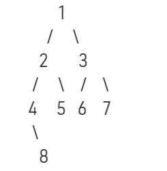
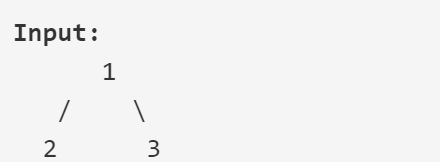
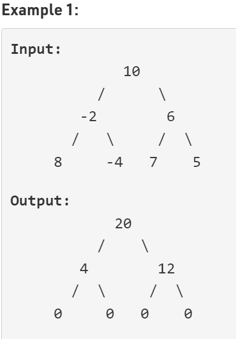
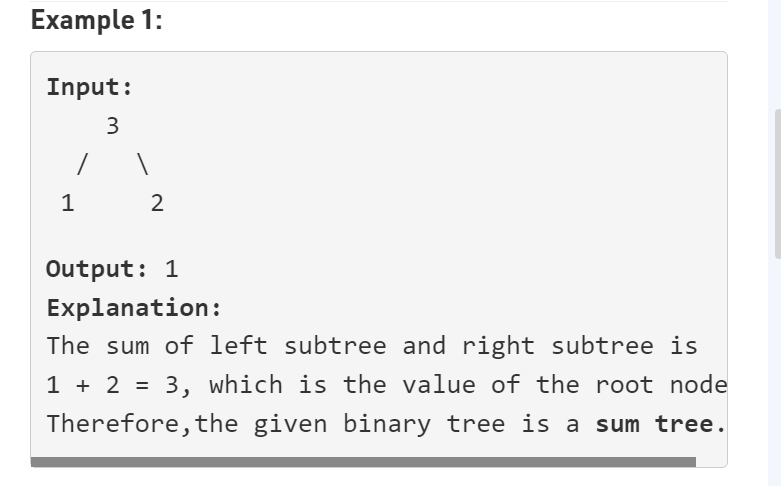
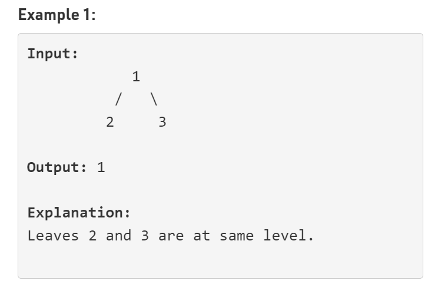
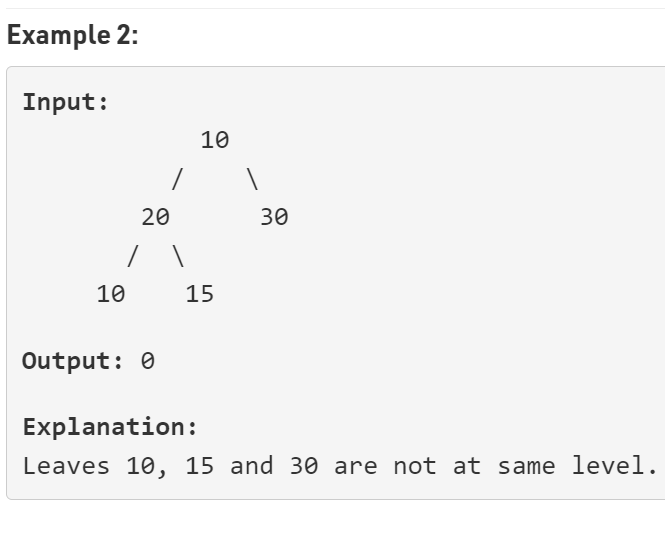

### 3. Mirror Tree
Given a binary tree, the task is to create a new binary tree which is a mirror image of the given binary tree.

Examples: 

Inorder of original tree: 2 3 4 5 6  
Inorder of mirror tree: 6 5 4 3 2  
Mirror tree will be:  

Inorder of original tree: 12 1 2 8 9  
Inorder of mirror tree: 9 8 2 1 12  
- [Mirror tree](https://github.com/pskarthick15/Programming/blob/main/Trees/mirrortree.cpp)

### 4. Leftview

Given a Binary Tree, print Left view of it. Left view of a Binary Tree is set of nodes visible when tree is visited from Left side. The task is to complete the function leftView(), which accepts root of the tree as argument.

Left view of following tree is 1 2 4 8.

  
- [Leftview](https://github.com/pskarthick15/Programming/blob/main/Trees/leftview.cpp)

### 5. Topview

Given below is a binary tree. The task is to print the top view of binary tree. Top view of a binary tree is the set of nodes visible when the tree is viewed from the top. For the given below tree

  

Top view will be: 2 1 3
Note: Return nodes from leftmost node to rightmost node.
- [Topview](https://github.com/pskarthick15/Programming/blob/main/Trees/topview.cpp)

### 6. Sum tree

Given a Binary Tree of size N , where each node can have positive or negative values. Convert this to a tree where each node contains the sum of the left and right sub trees of the original tree. The values of leaf nodes are changed to 0.

  

Expected Time Complexity: O(N)  
Expected Auxiliary Space: O(height of tree)  
- [Sum tree](https://github.com/pskarthick15/Programming/blob/main/Trees/sumtree.cpp)

### 7. Construct a tree and return its postorder given its inorder and preorder traversals

Given 2 Arrays of Inorder and preorder traversal. Construct a tree and print the Postorder traversal. 

Example 1:

Input:  
N = 4  
inorder[] = {1 6 8 7}  
preorder[] = {1 6 7 8}  
Output: 8 7 6 1  

Example 2:

Input:  
N = 6  
inorder[] = {3 1 4 0 5 2}  
preorder[] = {0 1 3 4 2 5}  
Output: 3 4 1 5 2 0
- [Construct tree](https://github.com/pskarthick15/Programming/blob/main/Trees/construct_tree1.cpp)

### 8. Check sum tree

Given a Binary Tree. Return true if, for every node X in the tree other than the leaves, its value is equal to the sum of its left subtree's value and its right subtree's value. Else return false.

An empty tree is also a Sum Tree as the sum of an empty tree can be considered to be 0. A leaf node is also considered a Sum Tree.

  

- [Check sum](https://github.com/pskarthick15/Programming/tree/main/Trees)

### 9. Leaf at same level

Given a Binary Tree, check if all leaves are at same level or not.

     

Expected Time Complexity: O(N)

Expected Auxiliary Space: O(height of tree)

- [Leaf at same level](https://github.com/pskarthick15/Programming/blob/main/Trees/leaf_at_same_level.cpp)

### 10. Given 2 trees check if they are mirror of each other or not

example:

   1 2 3  and 1 3 2 (Preorder of trees)  
Here print true or 1 as both trees are mirror of each other.  
- [Check Mirror](https://github.com/pskarthick15/Programming/blob/main/Trees/check_mirror.cpp)
